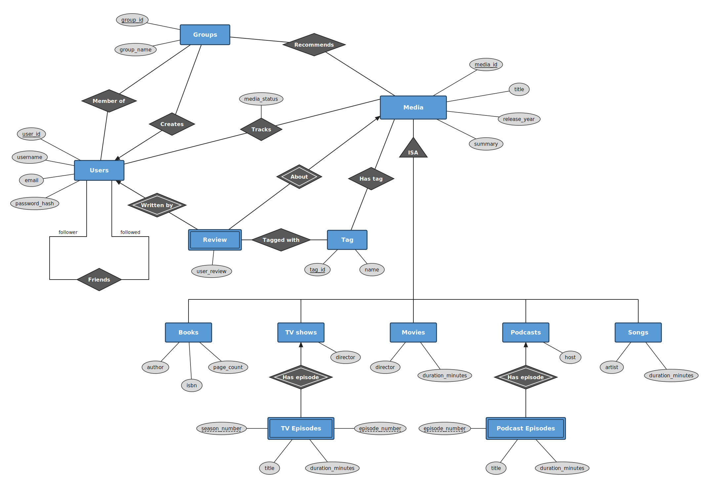

# Media Tracker: a vibe-based media recommender database

A MySQL database for finding books, TV shows, movies, podcasts and songs by **vibe**. Users tag media
with vibes such as *cozy* or *melancholy*, track and review what they consume, follow friends and
join groups that recommend media. Picking one item can suggest items of other types that share its vibes.

This repository contains the conceptual design (ERD and a design audit), the normalisation and
referential-integrity write-ups, the plan for the next sprint, and the relational implementation as SQL
(DDL, constraints, sample data, data loading, queries, tests).



## Requirements

- **MySQL 8.0.16 or newer.** Older versions accept `CHECK` constraints but silently ignore them.
  Check with `SELECT VERSION();`
- The `mysql` command-line client **or** MySQL Workbench. No other software is needed.

## Repository structure

```
.
├── README.md
├── .gitattributes                    keeps the CSV files on Unix line endings
├── .gitignore
└── media-tracker/
    ├── data/                         CSV files read by load_csv.sql
    │   ├── media.csv, books.csv, movies.csv, songs.csv, has_tag.csv
    ├── docs/
    │   ├── erd/erd_full.png          final entity-relationship diagram (also as erd_full.svg)
    │   ├── erd/erd_sprint1.png       the original Sprint 1 ERD, before the changes
    │   └── normalisation.md          FDs, keys and BCNF / 3NF / 4NF checks for all 18 tables
    └── sql/
        ├── run_all.sql               builds the database, then runs the safe demos and the integrity audit
        │
        ├── setup.sql                 creates the media_tracker database
        ├── drop_all.sql              drops all tables (clean slate)
        ├── schema_users_groups.sql   users, friends, user_groups, member_of
        ├── schema_media.sql          media, books, tv_shows, movies, podcasts, songs, tv_episodes,
        │                             podcast_episodes, tag, has_tag, and the view media_with_type
        ├── schema_activity.sql       tracks, reviews, review_tags, recommends
        ├── checks.sql                20 CHECK constraints
        ├── seed_data.sql             sample data for every table
        │
        ├── crud_operations.sql       INSERT / UPDATE / DELETE on every table
        ├── queries.sql               basic joins, filtering and sorting
        ├── alter_table.sql           ALTER TABLE demo: add a column, fill it, remove it
        ├── integrity_audit.sql       counts orphaned rows for every foreign key, and checks each media item is in one child table
        ├── check_tests.sql           24 statements that are meant to be rejected by the constraints
        ├── fk_tests.sql              tests every ON DELETE / ON UPDATE policy (RESTRICT refusals and CASCADEs)
        ├── normalization_tests.sql   8 tests showing the normal-form claims hold (no redundancy or anomalies)
        ├── load_csv.sql              loads new rows from ../data/*.csv
        └── queries_stretch.sql       optional recommendation queries (GROUP BY, COUNT, NOT EXISTS)
```

## Quick start (about one minute)

From the repository root:

```bash
cd media-tracker/sql
mysql -u root -p
```
```sql
SOURCE run_all.sql;
```

This creates the `media_tracker` database, builds the 18 tables and one view, adds the constraints and
sample data, then runs the CRUD, query and ALTER TABLE demos and the integrity audit. It prints their results
and finishes with no errors. The last table it prints is the audit: every `violations` value must be `0`.
It is safe to run again: it drops and rebuilds everything first (so it deletes the data in these tables).

**Check that it worked:**
```sql
USE media_tracker;
SHOW TABLES;                                   -- 18 tables and the view media_with_type
SELECT username FROM users;                    -- muskan, divina, grace
SELECT CONSTRAINT_NAME FROM information_schema.CHECK_CONSTRAINTS
WHERE CONSTRAINT_SCHEMA = 'media_tracker';     -- 20 rows
```

**MySQL Workbench:** `SOURCE` is not supported there. Open each file and run it (lightning-bolt button)
in this order: `setup` → `drop_all` → `schema_users_groups` → `schema_media` → `schema_activity` →
`checks` → `seed_data`. After that, `crud_operations`, `queries`, `alter_table` and `integrity_audit` can be run
in any order.

## What each script does

| Script | What to expect |
|---|---|
| `crud_operations.sql` | Inserts demo rows into all 18 tables (ids 801 and up), updates them, then deletes them. The database ends exactly as it began (3 users, 7 media items). |
| `queries.sql` | Three read-only queries: *pick a vibe* (media of every type with a given tag), *group picks* (what each group recommends and who created it) and the *episodes* of a TV show. |
| `alter_table.sql` | `DESCRIBE reviews`, adds a nullable `rating` column with a 1–5 CHECK, fills it for one review, then drops it again. |
| `integrity_audit.sql` | Read-only. One row per foreign key (22) plus two checks on the media child tables, each with a `violations` count that must be `0`. |
| `check_tests.sql` | See below. |
| `fk_tests.sql` | See below. |
| `normalization_tests.sql` | See below. |
| `load_csv.sql` | See below. |
| `queries_stretch.sql` | Optional. Recommendations from a picked item, from viewing history and from friends, and the season and episode counts, which are derived by counting episodes. These use `GROUP BY`, `COUNT` and `NOT EXISTS`. |

### Testing the constraints: `check_tests.sql`

Each statement is *supposed* to be rejected, and its comment says which error to expect. Run it after
`seed_data.sql`, from the `sql` folder, with `--force` so the client continues after each error:

```bash
mysql --force -t -u root -p < check_tests.sql
```

You should see **24 errors and nothing else going wrong**: twenty-two `ERROR 3819` (CHECK violated), one
`ERROR 1452` (foreign key to a missing parent) and one `ERROR 1451` (delete blocked because a row is still
referenced). The file ends with queries showing the data is back to the seed data. In Workbench, run the
statements one at a time and expect a red error on every `TEST`.

### Testing referential integrity: `fk_tests.sql` and `integrity_audit.sql`

`fk_tests.sql` checks every `ON DELETE` / `ON UPDATE` policy. It builds its own rows (ids 951 and up), tries
to break the rules, deletes parents to trigger the cascades, and cleans up after itself. Run it after
`seed_data.sql`, from the `sql` folder:

```bash
mysql --force -t -u root -p < fk_tests.sql
```

You should see **7 errors** (four `ERROR 1451`: a group creator, a tag in use and a referenced id cannot be
deleted or changed; three `ERROR 1452`: a row cannot point at a missing parent), followed by **19 result rows
in which `rows_left` equals `expected` (0)**. Those rows show that deleting a user, group, media item or show
leaves no child rows behind.

Then run `integrity_audit.sql`: all 24 `violations` values must still be `0`, which shows the tests left no
orphaned rows. Each audit row is a relational algebra constraint (every child value must appear in its parent), written as a `LEFT JOIN … IS NULL` query.

### Testing the normal forms: `normalization_tests.sql`

Eight tests show that the design has no redundancy or anomalies: a combined table is built only to compare
against (9 rows against our 6), then insertion, deletion and update are tried on the real tables, a multi-vibe
search is checked for duplicates, and MySQL is shown to reject a duplicate email. It runs inside a transaction
and rolls back at the end, so it changes no data. From the `sql` folder:

```bash
mysql -t -u root -p < normalization_tests.sql
```

You should see **8 result tables, every one ending in `PASS`**. The reasoning behind them (keys, FDs, BCNF, 3NF
and 4NF) is in `media-tracker/docs/normalisation.md`.

### Loading the CSV files: `load_csv.sql`

Adds 5 media items (ids 101–105) with their type-specific rows and tags. `LOAD DATA LOCAL INFILE` is off by
default on both the server and the client, so switch it on first. From the `sql` folder:

```bash
mysql --local-infile=1 -u root -p
```
```sql
SET GLOBAL local_infile = 1;
SOURCE load_csv.sql;
```

Run it after `seed_data.sql` (it uses the seed tags). Blank CSV fields become `NULL`, decimals such as `103.5`
load without being rounded, and running it twice does not create duplicates. Workbench instructions
are at the top of the file. If you see *"Loading local data is disabled"*, one of the two switches above is off.

## Design overview

- **18 tables in BCNF (so also 3NF) and 4NF.** People: `users`, `friends`, `user_groups`, `member_of`. Media: `media`, five child
  tables, two episode tables, `tag`, `has_tag`. Activity: `tracks`, `reviews`, `review_tags`, `recommends`.
  The full working (keys, functional dependencies, BCNF, 3NF and 4NF checks) is in `media-tracker/docs/normalisation.md`.
- **Inheritance (ISA).** `media` holds what every item has (title, year, summary). `books`,
  `tv_shows`, `movies`, `podcasts` (which have a `host`) and `songs` each hold only their own attributes and share
  `media_id` as primary key and foreign key to `media`. This avoids one wide table that is mostly NULL. Every media item is in exactly
  one child table, so its type is *derived*, not stored: the view `media_with_type` computes it.
- **Weak entity sets.** TV and podcast episodes cannot be identified without their show, so `tv_episodes` has the
  primary key `(media_id, season_number, episode_number)` and `podcast_episodes` has `(media_id, episode_number)`,
  each with `media_id` as a foreign key to its show. Season and episode counts are counted from these rows. A
  review is also a weak entity set: `reviews` is identified by the user who wrote it plus the media item it is
  about, `(user_id, media_id)`.
- **Relationships.** Many-to-many relationships (`friends`, `member_of`, `has_tag`, `tracks`, `reviews`,
  `recommends`) are link tables with composite primary keys. `friends` is a recursive relationship on `users`
  (follower and followed). *Creates* is many-to-one, so it is the column `user_groups.creator_id`.
- **Review tags.** A review can have many tags, which is the many-to-many relationship *Tagged with*, so the tags
  live in `review_tags` instead of repeating the review text once per tag. `normalisation.md` section 2 shows the
  anomalies this avoids, and section 4 shows why independent multi-valued facts sit in separate tables (4NF).
- **Foreign keys** all state their policy explicitly. Rows that only make sense with their parent (track lists,
  memberships, reviews, children of a media item, episodes) are `ON DELETE CASCADE`. A group's creator and a tag
  that is in use are `ON DELETE RESTRICT`, so a user who still owns a group cannot be deleted until the group is
  reassigned or removed. Every key is `ON UPDATE RESTRICT`, because ids never change. The policies are listed in the comment at the top of `schema_users_groups.sql`.
- **Data types.** `INT` ids with `AUTO_INCREMENT`, `VARCHAR` for names, `TEXT` for summaries and reviews, and
  `DECIMAL(5,2)` for durations in decimal minutes (`3.50` means 3 min 30 s, not 3:50). A `NULL` means "unknown"
  (for example a book without an ISBN).
- **Constraints.** `PRIMARY KEY`, `FOREIGN KEY`, `UNIQUE` and `NOT NULL` in the schema files, plus 20 named
  `CHECK` constraints in `checks.sql` (value lists, positive numbers and durations, valid years, simple email and
  ISBN-length rules, no self-follows, no blank text).
- **Naming.** The table is `user_groups` because `GROUPS` is a reserved word in MySQL 8. `password_hash` stores
  a hash, never a plain password; the values in the sample data are fake placeholders.

## Known limitations

- **"One child table per media item" is not enforced by MySQL.** Nothing stops a media item from having no child
  row, or from also having a row in a second child table (for example a movie in `books`); a `CHECK` cannot compare
  two tables. `integrity_audit.sql` reports both cases, and the last part of `check_tests.sql` demonstrates the gap.
- **Simple validation only.** The email check is a pattern (`x@y.z`, no spaces, one `@`) and the ISBN check only
  tests for 10 or 13 characters.
- **Sample data is illustrative.** Titles are real, but some counts and durations are placeholders.
