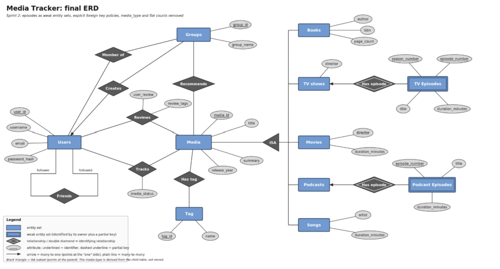

# A Vibe-Based Media Recommender Database

A MySQL database for finding books, TV shows, movies, podcasts and songs by **vibe**. Users tag media
with vibes such as *cozy* or *melancholy*, track and review what they consume, follow friends and
join groups that recommend media. Picking one item can suggest items of other types that share its vibes.

This repository contains the conceptual design (ERD), the normalisation work, and the relational
implementation as SQL (DDL, constraints, sample data, data loading, queries).



## Requirements

- **MySQL 8.0.16 or newer.** Older versions accept `CHECK` constraints but silently ignore them.
  Check with `SELECT VERSION();`
- The `mysql` command-line client **or** MySQL Workbench. No other software is needed.

## Repository structure

```
.
├── README.md
├── .gitattributes                    keeps the CSV files on Unix line endings
├── .gitignore
└── media-tracker/
    ├── data/                         CSV files read by load_csv.sql
    │   ├── media.csv, books.csv, movies.csv, songs.csv, has_tag.csv
    ├── docs/
    │   ├── erd/erd_final.png         Sprint 2 ERD (weak episode entities, no media_type)
    │   ├── erd/erd_full.png          Sprint 1 ERD
    │   └── normalisation.md          BCNF / 3NF / 4NF proof (short)
    └── sql/
        ├── run_all.sql               builds the database, then runs the three safe demos
        │
        ├── setup.sql                 creates the media_tracker database
        ├── drop_all.sql              drops all tables and the view (clean slate)
        ├── schema_users_groups.sql   users, friends, user_groups, member_of
        ├── schema_media.sql          media + 5 ISA children, tv_episodes, podcast_episodes (weak
        │                             entities), tag, has_tag, and the media_with_type view
        ├── schema_activity.sql       tracks, reviews, review_tags, recommends
        ├── checks.sql                20 CHECK constraints + 2 triggers (no self-follow)
        ├── seed_data.sql             sample data for every table
        │
        ├── crud_operations.sql       INSERT / UPDATE / DELETE on every table
        ├── queries.sql               basic joins, filtering and sorting
        ├── alter_table.sql           ALTER TABLE demo: add a column, fill it, remove it
        ├── check_tests.sql           28 statements that are meant to be rejected by the constraints
        ├── fk_tests.sql              8 PASS/FAIL tests: ON DELETE policies leave zero orphan rows
        ├── normalization_tests.sql   8 PASS/FAIL tests: no redundancy or anomalies (3NF/4NF evidence)
        ├── load_csv.sql              loads new rows from ../data/*.csv
        └── queries_stretch.sql       optional recommendation queries (GROUP BY, COUNT, NOT EXISTS)
```

## Quick start (about one minute)

From the repository root:

```bash
cd media-tracker/sql
mysql -u root -p
```
```sql
SOURCE run_all.sql;
```

This creates the `media_tracker` database, builds the 18 tables and 1 view, adds the constraints and sample data,
then runs the CRUD, query and ALTER TABLE demos. It prints their results and finishes with no errors.
It is safe to run again: it drops and rebuilds everything first (so it deletes the data in these tables).

**Check that it worked:**
```sql
USE media_tracker;
SHOW TABLES;                                   -- 19 rows: 18 tables + media_with_type
SELECT username FROM users;                    -- muskan, divina, grace
SELECT CONSTRAINT_NAME FROM information_schema.CHECK_CONSTRAINTS
WHERE CONSTRAINT_SCHEMA = 'media_tracker';     -- 20 rows
```

**MySQL Workbench:** `SOURCE` is not supported there. Open each file and run it (lightning-bolt button)
in this order: `setup` → `drop_all` → `schema_users_groups` → `schema_media` → `schema_activity` →
`checks` → `seed_data`. After that, `crud_operations`, `queries` and `alter_table` can be run in any order.

## Design notes (Sprint 2)

- **No `media_type` column.** A media item's type is the child table it is in (`books`,
  `tv_shows`, ...). Queries that need the type use the `media_with_type` view.
- **Episodes are weak entities.** `tv_episodes` is identified by its show plus
  `(season_number, episode_number)`; `podcast_episodes` by its podcast plus `episode_number`.
  Episode and season counts are computed with `COUNT(*)` (see `queries.sql`), not stored.
- **Foreign key policies.** Every foreign key has `ON DELETE CASCADE`, except
  `user_groups.creator_id`, which is `ON DELETE RESTRICT`: a user who still owns a group
  cannot be deleted. `fk_tests.sql` shows that deletes leave zero orphan rows.
- **Known limitation:** nothing yet stops one media item being in two child tables (for
  example both `movies` and `books`). This is planned as a trigger next sprint;
  the end of `check_tests.sql` shows the gap.
